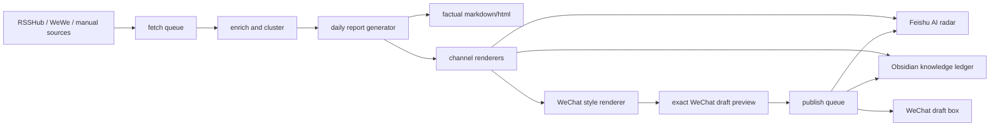

# Publishing Flow Review

Date: 2026-05-05

## Current Flow

## Review Findings

The main risk was that the report page could show one representation while the WeChat publisher sent another. The publisher used `styledWechatHtml || wechatHtml`, while the UI primarily exposed Markdown fields. That made it easy to believe a long article was being sent when the actual draft payload was a shorter HTML variant.

This has been fixed by introducing a shared WeChat draft article builder. The preview API and the publisher now read from the same function, so the previewed HTML is the actual `content` submitted to `draft/add`.

If `styledMarkdown` exists but `styledWechatHtml` is empty, the draft builder now converts the styled Markdown to a conservative WeChat HTML fallback. This prevents an edited style draft from silently falling back to the factual HTML body.

## Channel Responsibilities

WeChat is the long-form publishing channel. It should prioritize narrative structure, image placeholders, a clear opening, section-by-section explanation, representative links, and a final tracking question.

Feishu is the daily radar. It should stay short and operational: latest research, product/engineering movement, and follow-up signals worth watching.

Obsidian is the durable knowledge layer. It should keep summaries, paper/research notes, strange ideas, knowledge cards, and source links in a reusable Markdown shape.

## Maintainability Notes

Keep channel rendering in engine code rather than page components. UI pages should edit, preview, and enqueue; they should not decide publishing semantics.

Keep preview and publish payload construction shared. Any future WeChat API field change should happen in the shared draft builder or publisher wrapper, not separately in UI code.

Keep tests around the channel split. The important regression tests are: styled WeChat content is preferred, styled Markdown can produce publishable HTML, Feishu remains radar-like, and Obsidian remains ledger-like.

## Next Refactor Candidates

Split the reports page into smaller client components once the UI stabilizes: generation controls, report list, style sample import, draft editor, exact WeChat preview, and publish attempts.

Move inline style objects into a small page-local style module or shared dashboard primitives if more pages adopt this operational layout.

Add a worker-level integration smoke test that builds a report, resolves the WeChat draft article, and validates non-empty title, digest, content, and content length before enqueueing an external publish.
