# Agent WeChat Draft Workflow Design

## Goal

Build a low-cost, repeatable workflow where an external agent such as Codex can say one intent, generate or receive the needed images, and leave a stable, reviewable WeChat Official Account draft in the draft box.

The workflow must optimize for reusable process over one-off token-heavy prompting:

- Use already-ingested News Monitor content by default.
- Use a compact writing-style profile plus fixed personal IP rules.
- Let Codex use image2 for images when available, so the project does not spend image API budget in that path.
- Keep a provider interface for non-Codex image services.
- Improve the Categories page into a practical topic-discovery surface.

## Confirmed Product Direction

The selected approach is Agent API first.

News Monitor owns deterministic orchestration: topic selection from stored content, report/styled draft generation, image slot planning, image upload to WeChat material APIs, HTML assembly, draft creation, and publish-attempt tracking. Codex or another agent owns the user-facing natural-language request and, in `agent-image2` mode, image generation.

The app still only creates WeChat drafts. It must not automatically mass-send公众号 content.

## System Boundaries

### External Agent

The agent can:

- Trigger a draft workflow through CLI or HTTP.
- Pass an intent such as `最近热点内容` or `最新研究解读`.
- Receive image briefs and slot IDs.
- Generate images with image2 or another external tool.
- Return local image paths or image URLs to News Monitor.
- Ask News Monitor to complete the draft.

### News Monitor

News Monitor can:

- Query existing database content, hotspots, clusters, papers, favorites, and taxonomy fields.
- Generate factual reports and styled WeChat drafts using existing report/style machinery.
- Produce image briefs and deterministic image slots.
- Accept image returns from agents or HTTP image providers.
- Upload images to WeChat material endpoints.
- Replace image placeholders in WeChat HTML.
- Create WeChat drafts and record attempts.

News Monitor should not, by default:

- Browse the web for extra facts.
- Send long historical style samples into every model call.
- Call a paid image generation API when `agent-image2` is selected.

### WeChat

WeChat is the delivery target:

- Cover images use `thumb_media_id`, either configured or uploaded from returned/generated image assets.
- Inline images must be uploaded or transformed into WeChat-compatible content before draft creation.
- Draft creation remains the final action.

## Agent API

Add a single public capability named `wechatDraft.create`. It should be reachable from:

- Engine capability execution.
- `pnpm nm -- reports wechat-draft ...`.
- A web API route for external callers.

### Input Shape

```ts
type WechatDraftCreateInput = {
  intent: string;
  topic?: string;
  audience?: "personal" | "public";
  range?: "24h" | "72h" | "7d" | "30d" | "90d";
  topN?: number;
  minSources?: number;
  imageProvider?: "agent-image2" | "http-api" | "none";
  mode?: "prepare" | "complete";
  reportId?: string;
  images?: Array<{
    slotId: string;
    localPath?: string;
    url?: string;
    alt?: string;
  }>;
  allowWebSupplement?: boolean;
};
```

Default values:

- `audience`: `personal`
- `range`: `24h`
- `topN`: `10`
- `minSources`: `1`
- `imageProvider`: `agent-image2` for CLI/agent paths, `none` only when explicitly requested
- `mode`: `prepare`
- `allowWebSupplement`: `false`

If `allowWebSupplement` is false, all factual material must come from stored News Monitor data.

### Prepare Mode

`mode: "prepare"` creates or reuses a report and returns:

```ts
type WechatDraftPrepareResult = {
  status: "needs_images" | "ready_without_images";
  reportId: string;
  title: string;
  digest: string;
  contentSource: "styled" | "factual";
  markdown: string;
  wechatHtml: string;
  imageProvider: "agent-image2" | "http-api" | "none";
  imageSlots: Array<{
    slotId: "cover" | `section-${number}`;
    kind: "cover" | "section";
    topic: string;
    prompt: string;
    required: boolean;
  }>;
  nextAction: string;
};
```

For `agent-image2`, `nextAction` tells Codex to generate images and call complete mode with returned files or URLs.

For `none`, the result should still be useful: draft text, HTML, and briefs are returned, but no WeChat draft is created unless a configured default cover is available.

### Complete Mode

`mode: "complete"` accepts `reportId` and `images`. It:

1. Loads the report and the exact WeChat article fields used by preview/publishing.
2. Validates image slots against the stored `styleImageBriefs`.
3. Uploads returned images to WeChat material endpoints.
4. Replaces HTML image placeholders with WeChat-compatible image markup.
5. Creates the WeChat draft.
6. Records a publish attempt with enough output to inspect created `media_id`s.

The result returns:

```ts
type WechatDraftCompleteResult = {
  status: "draft_created";
  reportId: string;
  attemptId: string;
  draftMediaId: string;
  title: string;
  uploadedImages: Array<{
    slotId: string;
    mediaId: string;
    url?: string;
  }>;
};
```

## Image Provider Design

Introduce an image provider boundary, but keep implementation minimal.

### `agent-image2`

This provider does not call an image API. It returns image slots during prepare mode and waits for the agent to return images during complete mode.

Expected Codex flow:

```powershell
pnpm nm -- reports wechat-draft --intent "最新研究解读" --image-provider agent-image2 --json
# Codex reads imageSlots, generates images with image2, then:
pnpm nm -- reports wechat-draft --mode complete --report-id <id> --image cover=C:\path\cover.png --image section-1=C:\path\section.png --json
```

### `http-api`

This provider sends briefs to a configured endpoint and expects images back.

Environment variables:

```env
IMAGE_PROVIDER=http-api
IMAGE_PROVIDER_ENDPOINT=
IMAGE_PROVIDER_API_KEY=
IMAGE_PROVIDER_TIMEOUT_MS=120000
```

Request body:

```json
{
  "slots": [
    {
      "slotId": "cover",
      "kind": "cover",
      "topic": "topic",
      "prompt": "prompt"
    }
  ]
}
```

Response body:

```json
{
  "images": [
    {
      "slotId": "cover",
      "url": "https://example.com/generated.png",
      "alt": "cover image"
    }
  ]
}
```

### `none`

This provider creates no images. It is useful for dry runs, debugging, or text-only drafts. WeChat draft creation can proceed only if a default cover media ID is configured.

## WeChat Media Handling

Reuse existing token and material upload behavior where possible.

Required additions:

- Accept local image paths for CLI complete mode.
- Accept image URLs for HTTP complete mode.
- Validate non-empty image bytes and file size before upload.
- Upload cover and inline images through the same permanent-material path unless WeChat requires a different endpoint for inline rendering.
- Store upload outputs in publish-attempt `output`.
- Use the cover slot as `thumb_media_id` unless `WECHAT_MP_DEFAULT_THUMB_MEDIA_ID` is explicitly preferred.

If inline-image upload produces a URL, the final `styledWechatHtml` or publish payload should contain actual `` tags instead of `image2` placeholder paragraphs.

## Personal IP and Cost Policy

Use `writing_style_profiles` and `writing_style_samples` as the durable style source.

Add a compact personal IP config inside the active profile rules, or as a small engine constant until an edit UI is needed:

- Voice: restrained, clear judgment, few adjectives.
- Structure: observation, context, what changed, why it matters, next tracking points.
- Scope: AI research, AI products, agents, developer workflows, and knowledge work.
- Ending: a judgment or question, not slogan-like summary.

Runtime generation should use only the compact profile summary and current report material. It should not load full historical samples unless explicitly asked to regenerate the profile.

## Category Page Optimization

The Categories page becomes a low-cost topic-discovery surface.

### Page Goals

- Show whether the system has classified content.
- Show category coverage by domain, topic, and entity.
- Help the user or agent identify draft-worthy topics.
- Provide clear next actions when the page has no content.

### UI Shape

Left side:

- Dimension selector: domain, topic, entity.
- Category list ordered by item count and recency.
- Counts for items, sources, and selected state.

Top summary:

- Total loaded items.
- Items with category data.
- Items missing category data.
- Candidate topics count.

Main list:

- Title and source.
- Summary.
- Published/fetched time.
- Category tags.
- Category confidence and source: rules, LLM, or mixed.
- Favorite toggle.
- Optional action to use this category/topic as draft input.

### Empty States

If no items exist:

- Explain that there is no content in the selected window.
- Offer links/actions to import recommended sources and trigger fetch.

If items exist but no taxonomy exists:

- Explain that content exists but classification has not run or returned no tags.
- Offer a re-enrichment action.

If selected filters match nothing:

- Show clear-filter action.

The page must use valid UTF-8 Chinese copy. Existing mojibake text should be replaced in touched UI code.

## Data Flow

```mermaid
flowchart LR
  Agent["Codex or external agent"] --> Prepare["wechatDraft.create prepare"]
  Prepare --> Select["Stored content selection"]
  Select --> Report["Report + styled WeChat draft"]
  Report --> Slots["Image slots and briefs"]
  Slots --> Image2["Agent image2 or HTTP provider"]
  Image2 --> Complete["wechatDraft.create complete"]
  Complete --> Upload["WeChat material upload"]
  Upload --> Draft["WeChat draft/add"]
  Draft --> Attempt["publish_attempts output"]
```



## Error Handling

- Missing intent falls back to `最近热点内容`, but empty topic does not fail.
- No matching stored content returns a structured `no_content` result with suggested source/fetch actions.
- No active style profile falls back to deterministic default style.
- `agent-image2` prepare never fails because image2 is unavailable; it only returns briefs.
- Complete mode fails with `missing_required_image` when required image slots are absent and no default cover is configured.
- Bad local image paths fail before any WeChat draft call.
- Image upload failure records an error attempt and does not create a partial WeChat draft.
- WeChat token or draft failure reuses existing publish-attempt error recording.
- HTTP image provider timeout returns a provider-specific error and preserves the prepared report for retry.

## Testing

Add focused tests before implementation:

- Capability input normalization for `wechatDraft.create`.
- Prepare mode returns report ID, article fields, and image slots without calling image APIs.
- Complete mode validates slot IDs and rejects missing required images.
- HTML replacement turns `image2` placeholders into image markup.
- CLI argument parsing supports `--intent`, `--mode`, `--report-id`, `--image-provider`, and repeated `--image slot=path`.
- Category aggregation handles empty items, unclassified items, and classified items.
- Existing WeChat preview and publish tests remain valid.

## Non-Goals

- Fully autonomous web research by default.
- Auto mass-send to WeChat followers.
- Training or fine-tuning a writing model.
- Rebuilding the Reports page as a full writing studio.
- Committing visual brainstorm artifacts under `.superpowers`.
